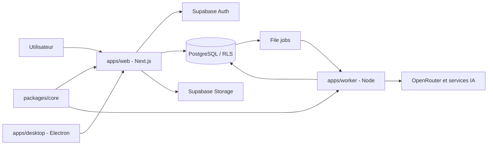

# Leanna Notebook

**Leanna Notebook est un espace de connaissance augmenté par l’IA.** Centralisez vos documents, explorez leur contenu avec des réponses reliées aux passages d’origine, échangez naturellement avec Leanna et Roxane, puis transformez vos recherches en livrables professionnels dans le Studio.

Leanna Notebook est une application multi-utilisateur disponible sur le web et via un client desktop Electron. Son architecture repose sur Next.js, Supabase et un worker Node.js pour les traitements asynchrones. Le projet évolue rapidement : les fonctionnalités décrites ci-dessous sont présentes dans le code, mais leur disponibilité effective dépend de la configuration des services et des validations indiquées.

## Fonctionnalités

| Domaine | Capacités repérées dans le code | Réserve |
|---|---|---|
| Notebooks | Organisation, membres, liens de partage, visites et copie | Parcours de bout en bout non retesté ici |
| Sources & documents | Import de PDF, pages web et textes ; extraction PDF page par page, indexation par lots et citations avec repères de page | OCR automatique désactivé par défaut ; activation et modèle configurables dans Réglages → Fonctionnalités → OCR des PDF scannés |
| Chat & recherche | Conversation en streaming, recherche documentaire hybride, citations vérifiables et génération directe de livrables Studio à la demande | Dépend de Supabase, des modèles IA et de sources prêtes et sélectionnées |
| Studio | Rapports, fiches de révision, quiz, cartes mentales, infographies, chronologies, comparatifs, glossaires, FAQ, diagrammes, contenus éditoriaux, plans d'étude, Audio Overview et images | Les rendus dépendent du worker, des modèles configurés et du type de livrable |
| Audio Overview | Création d'un script dialogué, synthèse vocale segmentée, mixage ffmpeg et export MP3 privé | Nécessite les identifiants TTS et ffmpeg sur le worker |
| Studio vocal | Gemini Live, recherche dans les sources, voix de Leanna et seconde voix Roxane activable ; commandes vocales pour demander un livrable Studio | Nécessite une clé Gemini Live ; Roxane reste optionnelle et les créations vocales requièrent le raccordement serveur correspondant |
| Prompts système | Catalogue éditable par utilisateur dans les réglages, avec sauvegarde et réinitialisation | Traçage des prompts de résumé encore incomplet |
| Modèles IA | Catalogue OpenRouter et préférences par fonctionnalité | Dépend de la clé OpenRouter |
| Découvrir & recherche web | Recherche externe, consultation de résultats et ajout de contenus au travail documentaire | Dépend de la configuration du fournisseur de recherche |
| Recherche approfondie | Agent autonome par étapes persistées : plan, recherches multi-requêtes, lecture complète des pages (anti-SSRF), extraction vérifiée, recoupement, ajout des sources, rapport cité dans le Studio ; pause, reprise, annulation, consignes en cours | Requiert `TAVILY_API_KEY` et OpenRouter côté worker ; migrations appliquées, parcours complet en direct pas encore validé |
| Graphe de connaissances | Entités, relations (déclarées / déduites) et affirmations extraites de chaque source avec passage exact ; résolution d'identité, fusion/séparation tracées ; graphe interactif borné et dépliable | Requiert OpenRouter côté worker ; migrations appliquées, extraction réelle pas encore validée |
| Contradictions | Comparaison structurée (dates, montants, quantités) puis qualification LLM ; décisions humaines historisées | Requiert OpenRouter côté worker ; détection couverte par des tests unitaires, pas encore validée sur données réelles |
| Electron | Client desktop, configuration de build et dépendance electron-updater | Installation et mise à jour non validées dans cette passe |
| Facturation réelle | Mode de facturation configurable | README et code de configuration indiquent un mode simulé par défaut |
| Google Drive | Type de source prévu dans le modèle de données | Connecteur de bout en bout non confirmé |
| Présentations | Type `slide_deck` présent dans l'enum SQL | Non accepté par le schéma de création Studio inspecté |

Une fonctionnalité présente dans le code n'est pas nécessairement validée en production. Les intégrations IA, le worker et les droits d'accès doivent être configurés pour obtenir le parcours complet.


## Ce que vous pouvez faire avec Leanna

1. **Rassembler** vos PDF, pages web et notes dans des notebooks séparés par sujet.
2. **Interroger** vos sources en langage naturel et retrouver les extraits qui étayent les réponses.
3. **Échanger à la voix** avec Leanna ; Roxane peut intervenir comme seconde voix pour apporter un autre angle.
4. **Produire dans le Studio** un rapport, une synthèse, un guide, des fiches, un quiz, une chronologie, une infographie ou un autre format pris en charge. Les demandes explicites peuvent être lancées depuis le chat ; le Studio vocal dispose également d'un outil de création dédié.
5. **Exporter** les livrables prêts dans les formats pris en charge : Markdown, texte, HTML et JSON ; MP3 pour les Audio Overview.
6. **Lancer une recherche approfondie** : Leanna planifie, cherche et lit le web, ajoute les sources pertinentes au notebook et rédige un rapport cité dans le Studio.
7. **Explorer le graphe de connaissances** de vos sources et vérifier, passage à l'appui, pourquoi deux éléments sont liés.
8. **Traiter les contradictions** détectées entre documents et garder l'historique de vos décisions.

Voir [Deep Research, Knowledge Graph et contradictions](docs/technical/DEEP_RESEARCH_KNOWLEDGE_GRAPH.md).

### PDF volumineux et OCR

L'extraction des PDF natifs est réalisée page par page, avec reconstruction des lignes et conservation des repères de page. La vectorisation est effectuée par lots. Pour les PDF scannés dépourvus de couche texte exploitable, un OCR optionnel peut être activé dans **Réglages → Fonctionnalités → OCR des PDF scannés**. Vous pouvez choisir le modèle OpenRouter et le moteur OCR. La limite actuelle documentée est de 40 Mo par PDF OCR ; le découpage des très gros scans en lots de pages n'est pas encore disponible. Voir [PDF OCR](docs/technical/PDF_OCR.md).

## Architecture technique

- **Web :** Next.js 15.5.29, React 19.1.0, TypeScript, Tailwind CSS 4, Radix UI.
- **Worker :** Node.js 24, TypeScript natif, traitements asynchrones persistés en base.
- **Données :** Supabase PostgreSQL 17, Auth, Storage privé, RLS, pgvector et recherche plein texte.
- **IA :** OpenRouter, Gemini Live, Deepgram, ElevenLabs, Tavily ; Voyage et Mistral sont également prévus comme options d'embeddings.
- **Desktop :** Electron 38, electron-builder, electron-updater.
- **Code partagé :** `packages/core` pour la résolution des citations.



Le worker consomme les jobs persistés en base. Le système décrit dans le code utilise des jobs, quotas et états de progression. Voir [Architecture de la génération d’images](docs/architecture/IMAGE_GENERATION_ARCHITECTURE.md).

## Démarrage local

### Prérequis
- Node.js 24
- pnpm
- Docker pour Supabase local
- ffmpeg pour le pipeline Audio Overview

### Installation
```bash
git clone https://github.com/moonback/leanna-notebook.git
cd leanna-notebook
pnpm install
pnpm db:start
```

Configurez les variables web et worker à partir des paramètres listés ci-dessous et des exemples d'environnement présents dans chaque application. Renseignez les secrets uniquement dans vos fichiers locaux ou votre gestionnaire de secrets.

### Lancement
Terminal 1 :
```bash
pnpm dev
```

Terminal 2 :
```bash
pnpm --dir apps/worker start
```

Web : http://localhost:3000. Supabase local : API 58321, PostgreSQL 58322, Studio 58323, boîte mail de test 58324.

Pour réinitialiser la base locale (opération destructive) : `pnpm db:reset`.

Voir [Documentation web](apps/web/README.md) et [Documentation desktop](apps/desktop/README.md).

## Variables d'environnement

Les variables principales sont :

| Variable | Utilité |
|---|---|
| `NEXT_PUBLIC_SUPABASE_URL`, `NEXT_PUBLIC_SUPABASE_ANON_KEY` | Connexion web à Supabase |
| `SUPABASE_URL`, `SUPABASE_ANON_KEY`, `SUPABASE_SERVICE_ROLE_KEY` | Accès Supabase serveur/worker |
| `OPENROUTER_API_KEY`, `OPENROUTER_CHAT_MODEL` | Chat, génération Studio et OCR OpenRouter |
| `OPENROUTER_EMBEDDINGS_MODEL`, `EMBEDDINGS_PROVIDER`, `EMBEDDINGS_MODEL`, `EMBEDDINGS_API_KEY` | Embeddings |
| `GEMINI_API_KEY` | Sessions vocales Gemini Live |
| `TAVILY_API_KEY` | Recherche web / Fast Research ; **requise sur le worker** pour la recherche approfondie |
| `DEEP_RESEARCH_MAX_COST_USD`, `OPENROUTER_TIMEOUT_MS` | Facultatives (worker) : plafond de coût par recherche approfondie, délai maximal d'un appel LLM |
| `DEEPGRAM_API_KEY`, `STT_MODEL`, `STT_LANGUAGE` | Transcription audio |
| `ELEVENLABS_API_KEY`, `AUDIO_OVERVIEW_HOST_VOICE_ID`, `AUDIO_OVERVIEW_GUEST_VOICE_ID`, `FFMPEG_PATH` | Audio Overview |
| `APP_URL`, `BILLING_MODE` | URL publique et mode de facturation |
| `NEXT_PUBLIC_LEGAL_ENTITY`, `NEXT_PUBLIC_LEGAL_EMAIL` | Informations des pages légales |

La configuration doit rester cohérente entre le web et le worker. Ne versionnez jamais de secrets. Web et worker doivent utiliser des embeddings compatibles de même dimension (1024 selon la configuration décrite).

## Scripts

| Commande | Fonction |
|---|---|
| `pnpm dev` | Démarrer le web |
| `pnpm --dir apps/worker start` | Démarrer le worker |
| `pnpm typecheck` | Vérification TypeScript |
| `pnpm lint` | ESLint |
| `pnpm test` | Tests Vitest des packages |
| `pnpm db:start` / `pnpm db:reset` | Supabase local |
| `pnpm db:test` | Tests pgTAP |
| `pnpm desktop:dev` | Client Electron en développement |
| `pnpm desktop:build` / `pnpm desktop:dist:win` | Build desktop / Windows |

Ces commandes proviennent des manifestes du dépôt ; elles n'ont pas été exécutées pendant cette passe distante.

## Documentation

Documents disponibles dans le dépôt :
- [Vision produit](docs/PRODUCT_VISION.md)
- [Architecture de la génération d’images](docs/architecture/IMAGE_GENERATION_ARCHITECTURE.md)
- [Audit de la génération d’images](docs/audits/IMAGE_GENERATION_AUDIT.md)
- [Extraction et OCR des PDF](docs/technical/PDF_OCR.md)
- [Deep Research, Knowledge Graph et contradictions](docs/technical/DEEP_RESEARCH_KNOWLEDGE_GRAPH.md)
- [Configuration OpenRouter Nano Banana](docs/technical/OPENROUTER_NANO_BANANA.md)
- [Documentation web](apps/web/README.md)
- [Documentation desktop](apps/desktop/README.md)

## Contribution

1. Créer une branche dédiée depuis `main` (par exemple `feat/...`, `fix/...` ou `docs/...`).
2. Garder les changements ciblés et ajouter/adapter les tests pertinents.
3. Exécuter `pnpm typecheck`, `pnpm lint`, `pnpm test` et, pour les changements SQL, `pnpm db:test`.
4. Ouvrir une Pull Request vers `main` avec le périmètre, les tests exécutés et les limites connues.

La structure est organisée autour de `apps/web`, `apps/worker`, `apps/desktop`, `packages/core` et `supabase`.

## Licence

Aucun fichier `LICENSE` n'a été trouvé à la racine via l'API GitHub lors de la première passe. La licence du projet doit être confirmée avant toute redistribution ; aucune licence n'est présumée ici.

---

**État documentaire :** les fonctionnalités et limites ci-dessus reflètent les éléments présents dans le dépôt au moment de cette mise à jour. Les tests, le typecheck et les validations réelles des intégrations doivent être exécutés dans l'environnement de développement avant une mise en production.
