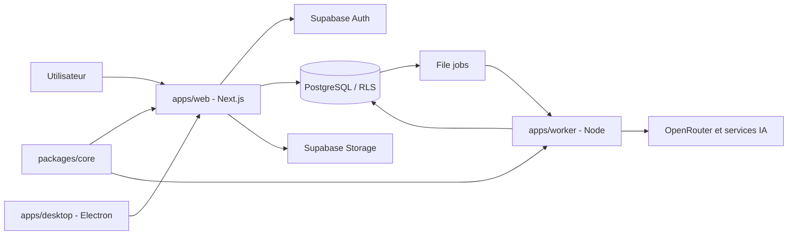

# Leanna Notebook

Assistant de recherche documentaire : rassemblez vos sources, posez des questions à leur sujet et vérifiez les réponses grâce à des citations qui renvoient aux passages d'origine. Le Studio transforme le corpus en supports de synthèse, de création et de révision.

Leanna Notebook est une application SaaS multi-utilisateur fondée sur Next.js, Supabase et un worker Node. Le dépôt contient également un client desktop Electron. Le projet est en développement actif ; les états ci-dessous distinguent les capacités repérées dans le code des validations opérationnelles qui restent à effectuer.

## Fonctionnalités

| Domaine | Capacités repérées dans le code | Réserve |
|---|---|---|
| Notebooks | Organisation, membres, liens de partage, visites et copie | Parcours de bout en bout non retesté ici |
| Sources | Import de fichiers, pages web, URL publiques TikTok avec transcription automatique Deepgram, sélection, recherche et citations | Les vidéos privées, bloquées ou non accessibles sans connexion ne peuvent pas être transcrites ; OCR des PDF scannés non confirmé |
| Chat | Streaming SSE, recherche hybride, citations résolues et notes | Dépend de la configuration Supabase/IA |
| Studio | Rapports, fiches, quiz, cartes mentales, infographies, chronologies, comparatifs, glossaires, FAQ, diagrammes, contenus éditoriaux et plans d'étude | 13 types acceptés par l'API ; résultats visuels non validés exhaustivement |
| Audio Overview | Script dialogué à deux voix, TTS segmenté, mixage ffmpeg et MP3 privé | Nécessite les identifiants TTS et ffmpeg sur le worker |
| Mode vocal | Gemini Live, recherche RAG, Leanna et co-animatrice Roxane | Roxane est désactivée par défaut ; deux premiers échanges silencieux |
| Prompts système | Catalogue éditable par utilisateur dans les réglages, avec sauvegarde et réinitialisation | Traçage des prompts de résumé encore incomplet |
| Modèles IA | Catalogue OpenRouter et préférences par fonctionnalité | Dépend de la clé OpenRouter |
| Fast Research / Découvrir | Routes de recherche, import de résultats et ouverture de découvertes | Parcours complet non retesté ici |
| Electron | Client desktop, configuration de build et dépendance electron-updater | Installation et mise à jour non validées dans cette passe |
| Facturation réelle | Mode de facturation configurable | README et code de configuration indiquent un mode simulé par défaut |
| Google Drive | Type de source prévu dans le modèle de données | Connecteur de bout en bout non confirmé |
| Présentations | Type `slide_deck` présent dans l'enum SQL | Non accepté par le schéma de création Studio inspecté |

Le statut « repéré dans le code » ne signifie pas qu'une fonctionnalité a été testée en production. Voir le [rapport d'audit](docs/DOCUMENTATION_AUDIT.md).

## Architecture technique

- **Web :** Next.js 15.5.29, React 19.1.0, TypeScript, Tailwind CSS 4, Radix UI.
- **Worker :** Node.js 24, TypeScript natif, traitements asynchrones persistés en base.
- **Données :** Supabase PostgreSQL 17, Auth, Storage privé, RLS, pgvector et recherche plein texte.
- **IA :** OpenRouter, Gemini Live, Deepgram, ElevenLabs, Tavily ; Voyage et Mistral sont également prévus comme options d'embeddings.
- **Desktop :** Electron 38, electron-builder, electron-updater.
- **Code partagé :** `packages/core` pour la résolution des citations.



Le worker consomme les jobs persistés en base. Le système décrit dans le code utilise des jobs, quotas et états de progression. Voir [Architecture](docs/ARCHITECTURE.md).

## Démarrage local

### Prérequis
- Node.js 24
- pnpm
- Docker pour Supabase local
- ffmpeg pour le pipeline Audio Overview

### Installation
```bash
git clone https://github.com/moonback/leanna-notebook.git
cd leanna-notebook
pnpm install
pnpm db:start
```

Configurez les variables web et worker. Le README précédent référençait `apps/web/.env.example`, dont l'existence n'a pas été confirmée lors de l'audit distant. L'exemple worker accessible est `apps/worker/.env.example`.

### Lancement
Terminal 1 :
```bash
pnpm dev
```

Terminal 2 :
```bash
pnpm --dir apps/worker start
```

Web : http://localhost:3000. Supabase local : API 58321, PostgreSQL 58322, Studio 58323, boîte mail de test 58324.

Pour réinitialiser la base locale (opération destructive) : `pnpm db:reset`.

Voir [Installation](docs/INSTALLATION.md) et [Configuration](docs/CONFIGURATION.md).

## Variables d'environnement

Les variables principales sont :

| Variable | Utilité |
|---|---|
| `NEXT_PUBLIC_SUPABASE_URL`, `NEXT_PUBLIC_SUPABASE_ANON_KEY` | Connexion web à Supabase |
| `SUPABASE_URL`, `SUPABASE_ANON_KEY`, `SUPABASE_SERVICE_ROLE_KEY` | Accès Supabase serveur/worker |
| `OPENROUTER_API_KEY`, `OPENROUTER_CHAT_MODEL` | Chat et génération |
| `OPENROUTER_EMBEDDINGS_MODEL`, `EMBEDDINGS_PROVIDER`, `EMBEDDINGS_MODEL`, `EMBEDDINGS_API_KEY` | Embeddings |
| `GEMINI_API_KEY` | Gemini Live |
| `TAVILY_API_KEY` | Fast Research |
| `DEEPGRAM_API_KEY`, `STT_MODEL`, `STT_LANGUAGE` | Transcription audio et des vidéos TikTok publiques importées par URL |
| `ELEVENLABS_API_KEY`, `AUDIO_OVERVIEW_HOST_VOICE_ID`, `AUDIO_OVERVIEW_GUEST_VOICE_ID`, `FFMPEG_PATH` | Audio Overview |
| `APP_URL`, `BILLING_MODE` | URL publique et mode de facturation |
| `NEXT_PUBLIC_LEGAL_ENTITY`, `NEXT_PUBLIC_LEGAL_EMAIL` | Informations des pages légales |

La liste complète et les variables worker sont détaillées dans [Configuration](docs/CONFIGURATION.md). Ne versionnez jamais de secrets. Web et worker doivent utiliser des embeddings compatibles de même dimension (1024 selon la configuration décrite).

## Scripts

| Commande | Fonction |
|---|---|
| `pnpm dev` | Démarrer le web |
| `pnpm --dir apps/worker start` | Démarrer le worker |
| `pnpm typecheck` | Vérification TypeScript |
| `pnpm lint` | ESLint |
| `pnpm test` | Tests Vitest des packages |
| `pnpm db:start` / `pnpm db:reset` | Supabase local |
| `pnpm db:test` | Tests pgTAP |
| `pnpm desktop:dev` | Client Electron en développement |
| `pnpm desktop:build` / `pnpm desktop:dist:win` | Build desktop / Windows |

Ces commandes proviennent des manifestes du dépôt ; elles n'ont pas été exécutées pendant cette passe distante.

## Documentation

L'index de référence est [docs/README.md](docs/README.md).

Documents importants :
- [Architecture](docs/ARCHITECTURE.md)
- [Référence API](docs/API_REFERENCE.md)
- [Base de données](docs/DATABASE.md)
- [Catalogue des prompts IA](docs/AI_PROMPTS_CATALOG.md)
- [Gestion des prompts](docs/features/SYSTEM_PROMPTS.md)
- [Mode vocal](docs/features/VOICE_MODE.md)
- [Studio](docs/features/STUDIO.md)
- [Guide utilisateur](docs/user-guide/GETTING_STARTED.md)
- [Audit documentaire](docs/DOCUMENTATION_AUDIT.md)

## Contribution

1. Créer une branche dédiée depuis `main` (par exemple `feat/...`, `fix/...` ou `docs/...`).
2. Garder les changements ciblés et ajouter/adapter les tests pertinents.
3. Exécuter `pnpm typecheck`, `pnpm lint`, `pnpm test` et, pour les changements SQL, `pnpm db:test`.
4. Ouvrir une Pull Request vers `main avec le périmètre, les tests exécutés et les limites connues.

La structure est organisée autour de `apps/web`, `apps/worker`, `apps/desktop`, `packages/core` et `supabase`. Voir [Structure du projet](docs/PROJECT_STRUCTURE.md).

## Licence

Aucun fichier `LICENSE` n'a été trouvé à la racine via l'API GitHub lors de la première passe. La licence du projet doit être confirmée avant toute redistribution ; aucune licence n'est présumée ici.

---

**État documentaire :** la documentation décrit désormais plusieurs fonctionnalités confirmées dans le code, mais les validations locales et l'audit exhaustif des handlers restent à faire. Consulter [docs/DOCUMENTATION_AUDIT.md](docs/DOCUMENTATION_AUDIT.md).
