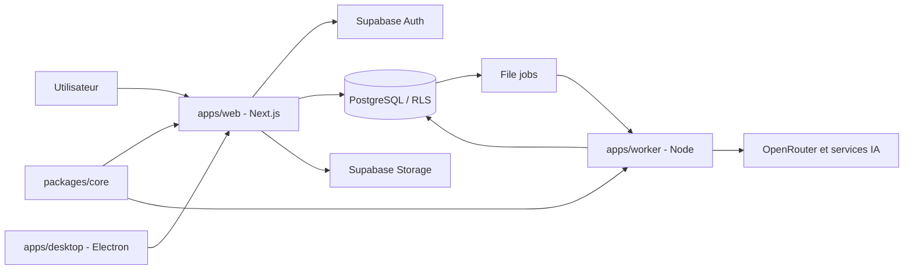

# Leanna Notebook

Assistant de recherche documentaire : rassemblez vos sources, posez des questions à leur sujet et vérifiez les réponses grâce à des citations qui renvoient aux passages d'origine. Le Studio transforme le corpus en supports de synthèse et de révision.

Leanna Notebook est une application SaaS multi-utilisateur fondée sur Next.js, Supabase et un worker Node. Le dépôt contient également un client desktop Electron. Le projet est en développement actif ; les fonctionnalités et limites ci-dessous distinguent les capacités décrites du produit des éléments encore en cours.

## Fonctionnalités

| Domaine | Capacités décrites | État documentaire |
|---|---|---|
| Notebooks | Organisation, recherche, partage privé, liens et copie | Disponible selon le README |
| Sources | PDF, Office, EPUB, texte, CSV, audio, web, notes | Disponible selon le README ; OCR PDF scanné absent |
| Chat | Streaming, recherche hybride, citations vérifiables, notes | Disponible selon le README |
| Studio | Rapports, fiches, quiz, cartes mentales | Disponible selon le README |
| Audio Overview | Script deux voix, ElevenLabs, ffmpeg, MP3 | Implémentation signalée sur branche dédiée ; validation restante |
| Gemini Live | Conversation audio bidirectionnelle et recherche RAG | Décrit comme disponible dans le README |
| Fast Research / Découvrir | Recherche web et galerie éditoriale | Présents dans le README ; vérifier la branche courante |
| Electron | Client desktop et build Windows NSIS | Scripts présents ; parcours de mise à jour à valider |
| Facturation réelle | Stripe / paiement | Non disponible : mode simulé |
| Emails applicatifs | Invitations et notifications | Non disponible selon le README |
| Google Drive | Connecteur | À faire selon le README |
| Infographies / présentations | Génération visuelle | À faire selon le tableau d'avancement |

Les détails et réserves sont documentés dans [la vue d'ensemble](docs/PROJECT_OVERVIEW.md) et [le rapport d'audit](docs/DOCUMENTATION_AUDIT.md).

## Architecture technique

- **Web :** Next.js 15.5.29, React 19.1.0, TypeScript, Tailwind CSS 4, Radix UI.
- **Worker :** Node.js 24, TypeScript natif, traitements asynchrones persistés en base.
- **Données :** Supabase PostgreSQL 17, Auth, Storage privé, RLS, pgvector et recherche plein texte.
- **IA :** OpenRouter, Gemini Live, Deepgram, ElevenLabs, Tavily ; Voyage et Mistral sont également prévus comme options d'embeddings.
- **Desktop :** Electron 38, electron-builder, electron-updater.
- **Code partagé :** `packages/core` pour la résolution des citations.



Le worker consomme les jobs persistés en base. Le README décrit la réclamation concurrente avec `SKIP LOCKED`, des baux renouvelés par heartbeat, des retries et une gestion de quotas à la création/fin du job. Voir [Architecture](docs/ARCHITECTURE.md).

## Démarrage local

### Prérequis
- Node.js 24
- pnpm
- Docker pour Supabase local
- ffmpeg pour le pipeline Audio Overview

### Installation
```bash
git clone https://github.com/moonback/leanna-notebook.git
cd leanna-notebook
pnpm install
pnpm db:start
```

Configurez les variables web et worker. Le README référence `apps/web/.env.example` ; l'existence du fichier n'a pas pu être confirmée durant l'audit distant. L'exemple worker accessible est `apps/worker/.env.example`.

### Lancement
Terminal 1 :
```bash
pnpm dev
```

Terminal 2 :
```bash
pnpm --dir apps/worker start
```

Web : http://localhost:3000. Supabase local : API 58321, PostgreSQL 58322, Studio 58323, boîte mail de test 58324.

Pour réinitialiser la base locale (opération destructive) : `pnpm db:reset`.

Voir [Installation](docs/INSTALLATION.md) et [Configuration](docs/CONFIGURATION.md).

## Variables d'environnement

Les variables principales sont :

| Variable | Utilité |
|---|---|
| `NEXT_PUBLIC_SUPABASE_URL`, `NEXT_PUBLIC_SUPABASE_ANON_KEY` | Connexion web à Supabase |
| `SUPABASE_URL`, `SUPABASE_ANON_KEY`, `SUPABASE_SERVICE_ROLE_KEY` | Accès worker/serveur |
| `OPENROUTER_API_KEY`, `OPENROUTER_CHAT_MODEL` | Chat et génération |
| `OPENROUTER_EMBEDDINGS_MODEL`, `EMBEDDINGS_PROVIDER`, `EMBEDDINGS_MODEL`, `EMBEDDINGS_API_KEY` | Embeddings |
| `GEMINI_API_KEY` | Gemini Live |
| `TAVILY_API_KEY` | Fast Research |
| `DEEPGRAM_API_KEY`, `STT_MODEL`, `STT_LANGUAGE` | Transcription audio |
| `ELEVENLABS_API_KEY`, `AUDIO_OVERVIEW_HOST_VOICE_ID`, `AUDIO_OVERVIEW_GUEST_VOICE_ID`, `FFMPEG_PATH` | Audio Overview |
| `APP_URL`, `BILLING_MODE` | URL publique et mode de facturation |
| `NEXT_PUBLIC_LEGAL_ENTITY`, `NEXT_PUBLIC_LEGAL_EMAIL` | Informations des pages légales |

La liste complète et les variables worker sont détaillées dans [Configuration](docs/CONFIGURATION.md). Ne versionnez jamais de secrets. Web et worker doivent utiliser des embeddings compatibles de même dimension (1024 selon le README).

## Scripts

| Commande | Fonction |
|---|---|
| `pnpm dev` | Démarrer le web |
| `pnpm --dir apps/worker start` | Démarrer le worker |
| `pnpm typecheck` | Vérification TypeScript |
| `pnpm lint` | ESLint |
| `pnpm test` | Tests Vitest des packages |
| `pnpm db:start` / `pnpm db:reset` | Supabase local |
| `pnpm db:test` | Tests pgTAP |
| `pnpm desktop:dev` | Client Electron en développement |
| `pnpm desktop:build` / `pnpm desktop:dist:win` | Build desktop / Windows |

Ces commandes proviennent des manifestes racine et des packages web, worker et desktop. Leur exécution n'a pas été réalisée pendant cet audit distant.

## Documentation

L'index de référence est [docs/README.md](docs/README.md). Il donne accès aux guides d'installation, à l'architecture, à l'API, à Supabase, aux workers, à l'IA, aux prompts, à Electron, à la sécurité, aux fonctionnalités et aux guides utilisateur.

Documents importants :
- [Architecture](docs/ARCHITECTURE.md)
- [Référence API](docs/API_REFERENCE.md)
- [Base de données](docs/DATABASE.md)
- [Catalogue des prompts IA](docs/AI_PROMPTS_CATALOG.md)
- [Mode vocal](docs/features/VOICE_MODE.md)
- [Studio](docs/features/STUDIO.md)
- [Guide utilisateur](docs/user-guide/GETTING_STARTED.md)
- [Audit documentaire](docs/DOCUMENTATION_AUDIT.md)

## Contribution

1. Créer une branche dédiée depuis `main` (par exemple `feat/...`, `fix/...` ou `docs/...`).
2. Garder les changements ciblés et ajouter/adapter les tests pertinents.
3. Exécuter `pnpm typecheck`, `pnpm lint`, `pnpm test` et, pour les changements SQL, `pnpm db:test`.
4. Ouvrir une Pull Request vers `main` avec le périmètre, les tests exécutés et les limites connues.

La structure est organisée autour de `apps/web`, `apps/worker`, `apps/desktop`, `packages/core` et `supabase`. Voir [Structure du projet](docs/PROJECT_STRUCTURE.md).

## Licence

Aucun fichier `LICENSE` n'a été trouvé à la racine via l'API GitHub durant cet audit. La licence du projet doit être confirmée avant toute redistribution ; aucune licence n'est présumée ici.

---

**État documentaire :** base documentaire structurée, mais audit du code incomplet. Les limites précises sont consignées dans [docs/DOCUMENTATION_AUDIT.md](docs/DOCUMENTATION_AUDIT.md).