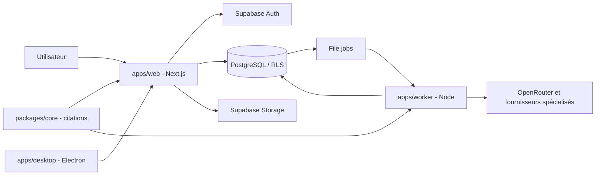

# Architecture

## Vue logique

## Composants vérifiés dans les manifestes et le README
- Web : Next.js 15.5.29, React 19.1.0, TypeScript, Tailwind CSS 4, Radix UI.
- Worker : Node, TypeScript exécuté nativement, Supabase JS.
- Core : package partagé de résolution des citations.
- Données : Supabase PostgreSQL 17, Auth, Storage, RLS, pgvector.
- Desktop : Electron 38, electron-builder et electron-updater.

Le README décrit les jobs persistants, la réclamation concurrente avec SKIP LOCKED, les baux/heartbeats et les retries. Ce diagramme est une architecture de contexte, pas une cartographie exhaustive des appels internes.