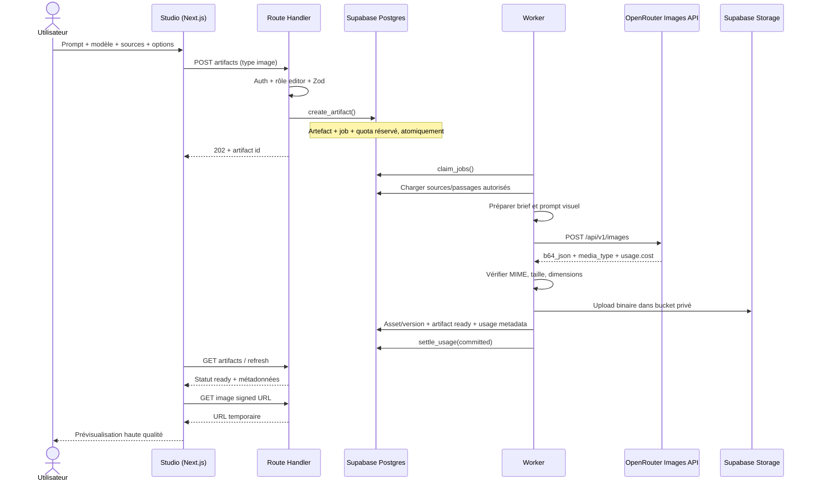
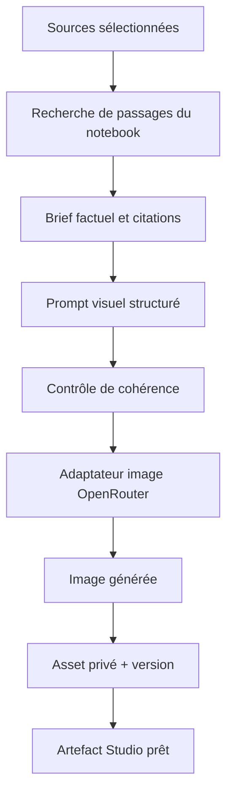

# Architecture cible — Génération d'images IA

> Proposition d'architecture basée sur l'état du dépôt au 11 novembre 2026. Aucun élément de cette architecture n'est implémenté à ce stade.

## 1. Principes

1. Réutiliser le Studio, ses artefacts, ses rôles, son worker et son ledger de crédits.
2. Isoler le protocole image du protocole chat texte.
3. Garder la clé OpenRouter exclusivement côté serveur/worker.
4. Stocker les images dans le bucket privé Supabase `artifacts`, jamais en base64 dans Postgres.
5. Conserver prompt, modèle, options, source IDs, usage fournisseur et versions pour audit/reproductibilité.
6. Déduire les contrôles UI des capacités réelles de chaque endpoint image.

## 2. Composants proposés

### Frontend
- Extension de `apps/web/app/notebook/[id]/studio.tsx` : type Image IA, CreateDialog, panneau de résultat et historique.
- Viewer dédié réutilisant Dialog, Button, Progress, Skeleton, Alert, toast, Panel et les primitives existantes.
- La bibliothèque est un filtre/vue des artefacts image du notebook, pas un nouveau stockage parallèle.
- Actions : créer, modifier, dupliquer, télécharger, supprimer ; affichage du modèle et du prompt.

### API
- Réutiliser `/api/v1/notebooks/[id]/artifacts` pour créer/lister un artefact image si le contrat existant reste adapté.
- Ajouter une route de détails/versions uniquement si la granularité ne tient pas dans la route artefact actuelle.
- Toute route vérifie `requireUser` et `requireRole`, puis parse un schéma Zod strict.
- Le client ne transmet jamais `storage_path`, workspace_id, usage_id ni coût réel.
- Le catalogue image interroge le catalogue officiel Image Models API via serveur et met en cache les capacités.

### Worker / services
- `ImageGenerationService` : orchestration métier (prompt, paramètres, référence, sauvegarde, usage).
- `OpenRouterImageAdapter` : implémentation fournisseur ; API Images en premier choix, Chat Completions multimodales en solution de compatibilité uniquement.
- `ImageModelRegistry` : modèle + endpoint + provider + supported_parameters + pricing lines + cache.
- `VisualPromptBuilder` : brief depuis sources, composition, style, contraintes et consignes d'édition.
- `ImageAssetStorage` : validation MIME/magic bytes, écriture Storage, métadonnées, URL signée.
- Le handler doit être enregistré dans `apps/worker/src/main.ts` et utiliser le cycle de vie `runOnce` existant.

## 3. Diagramme — flux de génération

## 4. Flux de contexte documentaire

Le contexte doit provenir exclusivement des sources sélectionnées (ou de toutes les sources si l'utilisateur choisit explicitement cette portée). Le worker actuel utilise `source_ids` et les passages récupérés par la recherche de chunks. Réutiliser ce mécanisme plutôt que d'envoyer les documents bruts à OpenRouter.

Le brief devrait distinguer :
- faits obligatoires à représenter ;
- relations/étapes documentées ;
- chiffres/statistiques explicitement cités ;
- éléments visuels suggérés mais non factuels ;
- informations absentes des sources à ne pas inventer.

Les passages fournis sont des données non fiables : aucune instruction trouvée dans un document ne doit remplacer les consignes système.

## 5. API OpenRouter : choix du protocole

### Choix principal : Images API

`POST https://openrouter.ai/api/v1/images` est la meilleure forme pour un service qui veut générer une image, recevoir un objet image, valider son MIME, l'enregistrer et mesurer le coût. Le guide officiel documente :
- découverte via `GET /api/v1/images/models` ;
- capacités définitives par fournisseur via `GET /api/v1/images/models/{author}/{slug}/endpoints` ;
- génération via `POST /api/v1/images` ;
- sortie `data[].b64_json`, `media_type`, `usage.cost` si disponible ;
- références via `input_references`.

Le modèle doit être présent dans le catalogue image et les paramètres doivent être validés pour le provider effectivement choisi. Ne pas déduire qu'un paramètre est accepté uniquement parce qu'il existe dans le schéma global.

### Compatibilité : Chat Completions

`POST /api/v1/chat/completions` est une alternative documentée pour les modèles image capables de retourner texte et image, en demandant `modalities: ["image", "text"]`. Elle est utile si le modèle ou la fonctionnalité requise est disponible via chat mais pas via Images API. Elle demande un parseur de contenu multimodal distinct ; ne pas utiliser `choices[0].message.content` comme une chaîne simple sans vérifier la forme des parties image.

**Décision de conception :** sélectionner un adaptateur selon le catalogue/capacités réels. Ne pas coder un fallback silencieux entre endpoints : les paramètres et formats de réponse diffèrent. Si le modèle n'est pas servi sur Images API, l'interface doit afficher le mode compatible et le backend utiliser le parseur Chat Completions dédié.

## 6. Modèle de données recommandé

### Option recommandée : artefact parent + table de versions/assets

Conserver `artifacts` comme agrégat Studio et ajouter une table, par exemple `artifact_image_versions` :
- `id` UUID PK ;
- `artifact_id` FK `artifacts` ON DELETE CASCADE ;
- `parent_version_id` nullable FK même table ;
- `version_number` entier ;
- `storage_path` unique ;
- `mime_type`, `size_bytes`, `width`, `height` ;
- `prompt`, `edit_instruction`, `model_id`, `endpoint/provider` ;
- `options` JSONB validé ;
- `source_ids` UUID[] snapshot ;
- `provider_usage` JSONB et `provider_cost_usd` NUMERIC nullable ;
- `status`, `error_code`, `created_at`, `created_by`.

Index : `(artifact_id, version_number desc)`, `parent_version_id`, `storage_path unique`. Ajouter RLS de lecture via le rôle du notebook. Les mutations restent exclusivement serveur/worker.

L'artefact principal porte le titre, le statut global, le type `image` et éventuellement un pointeur vers la version courante. Chaque variante ou édition devient une version distincte. Cela évite de multiplier des artefacts sans relation et rend l'historique explicite.

### Alternative MVP

Un seul fichier par artefact avec toutes les métadonnées dans `artifacts.content` JSONB est possible pour un prototype strictement mono-image, mais ne répond pas proprement aux exigences de versions, variantes et suppression granulaire. Ne pas retenir cette option pour le produit commercialisable demandé.

## 7. Stockage et URLs

- Bucket existant : `artifacts`, privé, limite déclarée 500 Mo.
- Chemin serveur proposé : `{workspace_id}/{notebook_id}/{artifact_id}/v{n}/image.{ext}`.
- Stocker le binaire décodé ; ne pas garder la chaîne base64 en Postgres.
- MIME autorisé : PNG/JPEG/WebP uniquement au MVP, SVG seulement si une validation/sanitisation dédiée est prévue.
- Vérifier magic bytes, dimensions et limite réelle avant upload.
- Lire via route protégée ou URL signée courte.
- Suppression : effacer les versions Storage puis les lignes DB dans un workflow robuste ; prévoir nettoyage des orphelins si l'une des opérations échoue.

## 8. Crédits et coûts

Conserver la transaction `create_artifact` + `reserve_usage` et le règlement `settle_usage` du worker. Ajouter un type d'usage dédié (`image_generation`) ou une clé de feature explicite ; ne pas supposer que l'enum SQL `artifact_type` suffit à définir les unités du plan.

Séparer :
- **prix utilisateur** : unités de crédits internes, déterminées par modèle/résolution/variantes dans une grille commerciale versionnée ;
- **coût fournisseur** : coût USD renvoyé par OpenRouter dans `usage.cost`, si présent ;
- **coût estimé** : valeur informative avant génération, jamais utilisée comme coût final.

La consommation fournisseur doit être enregistrée avec le request/model/provider et le payload usage. Une génération échouée doit être remboursée côté ledger. En cas de résultat généré mais stockage échoué, l'état est ambigu : réessayer l'upload avec le même résultat si conservé en mémoire, sinon traiter comme incident de réconciliation plutôt que de créer une double facturation. L'idempotency key doit empêcher deux générations sur double clic.

## 9. Sécurité

- Clé OpenRouter : env serveur/worker uniquement ; jamais envoyée au navigateur.
- Auth/permission : `requireRole` sur chaque accès et mutation.
- Références : IDs de sources/images appartenant au notebook, jamais chemin libre.
- Éviter SSRF : ne pas télécharger une URL arbitraire fournie par l'utilisateur ; résoudre les références depuis Storage après contrôle.
- Upload : vérifier MIME réel, magic bytes, dimensions, poids et décodage.
- Prompt : séparer instructions système des contenus documentaires.
- Abus : limite de génération par workspace/utilisateur, plafond de variantes, rate limit, idempotence.
- Logs : IDs, modèle, provider, statut, coût ; ne pas logger la clé, l'image base64 ni les documents complets.
- Nettoyage : supprimer les objets lors de la suppression de l'artefact et lors de suppression du compte/notebook.

## 10. Gestion des erreurs

Normaliser au minimum : `model_unavailable`, `unsupported_parameter`, `provider_rate_limited`, `provider_timeout`, `provider_rejected`, `invalid_image_response`, `image_too_large`, `storage_failed`, `cancelled`, `generation_failed`.

Le worker actuel réessaie les erreurs transitoires jusqu'à `max_attempts`, conserve la réservation pendant les tentatives et rembourse en échec terminal. Pour les timeouts après émission de requête, prévoir une stratégie d'idempotence/réconciliation : un timeout client ne prouve pas que le fournisseur n'a pas terminé sa génération.

## 11. Réutilisation / fichiers futurs

Réutiliser :
- `apps/web/app/notebook/[id]/studio.tsx`
- `apps/web/app/api/v1/notebooks/[id]/artifacts/route.ts`
- `apps/web/app/api/v1/artifacts/[id]/route.ts`
- `apps/worker/src/worker.ts`, `main.ts`
- `apps/worker/src/studio/generate.ts`
- `apps/web/lib/ai/openrouter.ts`
- `supabase/migrations/20261109010000_storage.sql`

Nouveaux fichiers possibles (noms indicatifs à confirmer avec conventions du dépôt) :
- `apps/worker/src/ai/image-generation.ts`
- `apps/worker/src/studio/image-prompt.ts`
- `apps/worker/src/studio/image-generation.ts`
- `apps/web/app/api/v1/ai/image-models/route.ts` ou catalogue intégré à l'API AI existante
- composants UI isolés si la taille de `studio.tsx` le justifie
- migration `supabase/migrations/*_studio_image_versions.sql`

Ces chemins sont des propositions, pas des fichiers actuellement présents.
